# CTS Departures

A real-time departure board for the **CTS** (Compagnie des Transports Strasbourgeois) network in Strasbourg, France.

The application polls the [CTS SIRI 2.0 API](https://www.cts-strasbourg.eu/fr/open-data/) and serves a live departure board to any browser over WebSocket — no page refresh needed. It can also drive a **Divoom Pixoo64** 64×64 LED display. A single self-contained binary serves both the API and the embedded web UI.

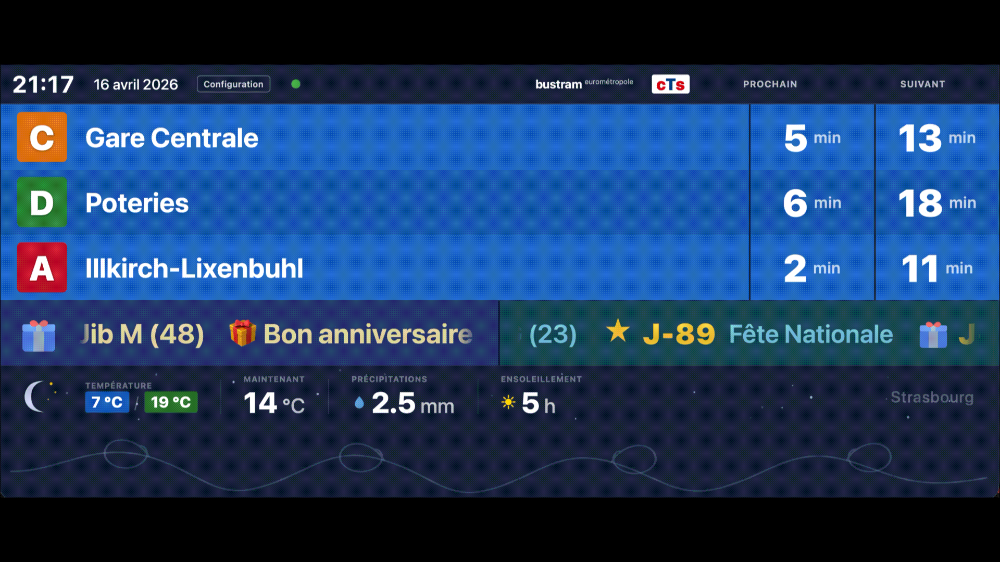

| Status — CTS | Status — Météoblue |
|:---:|:---:|
| 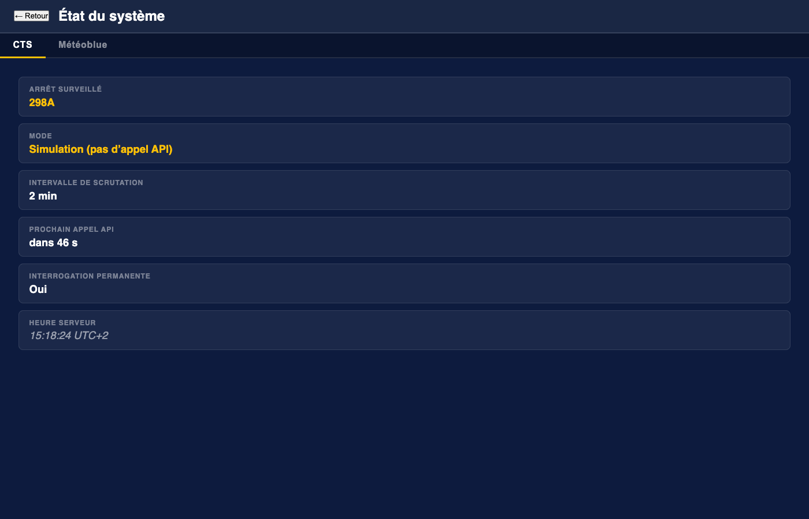 | 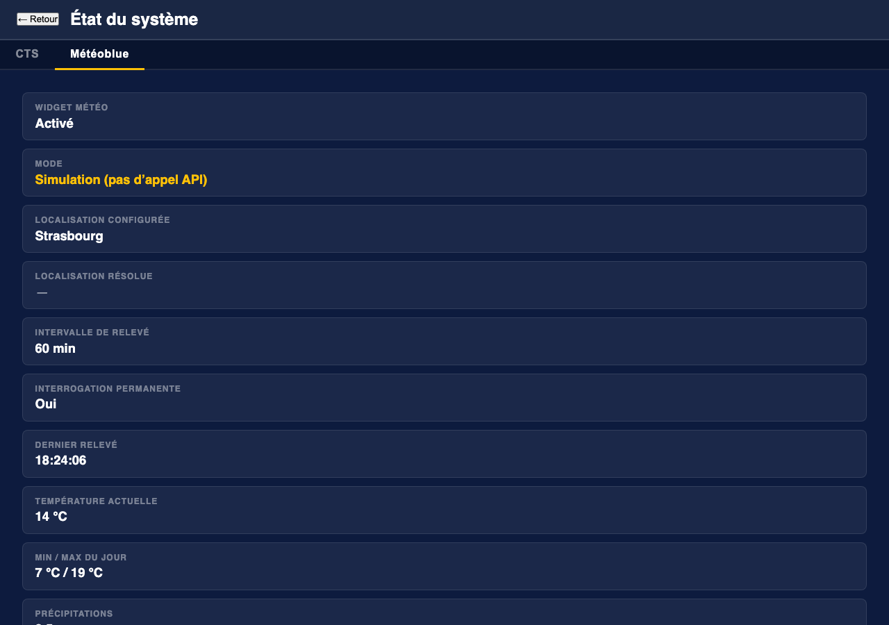 |

### PIXOO64 — Station + Strasbourg miniature

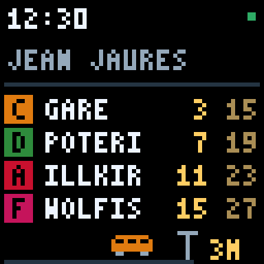

| Strasbourg miniature — day | Night |
|:---:|:---:|
| 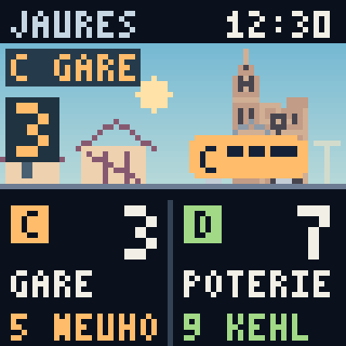 | 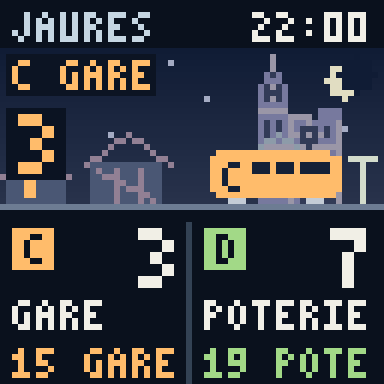 |

| Dawn | Sunset |
|:---:|:---:|
| 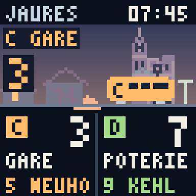 | 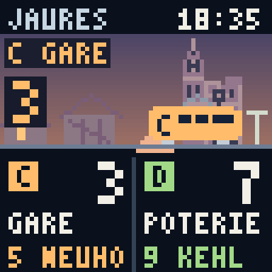 |

The Station layout from v1.5 is retained. Each design tours the configured platforms separately, followed by enabled birthday/Jour-J screens. Since v1.6.1, each miniature shows only its own platform’s C/D departures; the Jean Jaurès platform towards Gare Centrale / Poteries stays visible twice as long in both designs. Its light follows the sun over Strasbourg, calculated locally without a weather service.

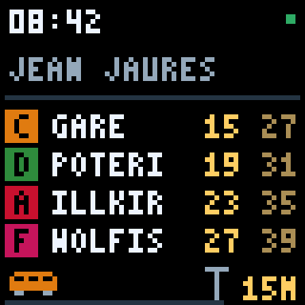

| Station — 4 lines | Station — 2 lines |
|:---:|:---:|
| 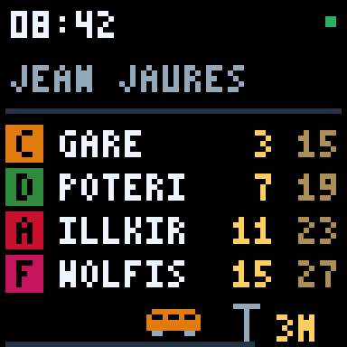 | 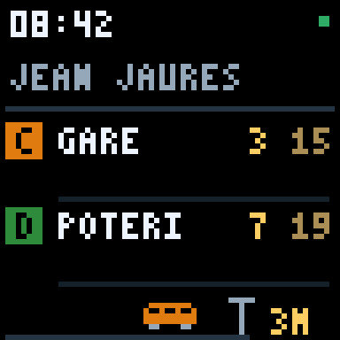 |

| Birthday | Jour J countdown |
|:---:|:---:|
| 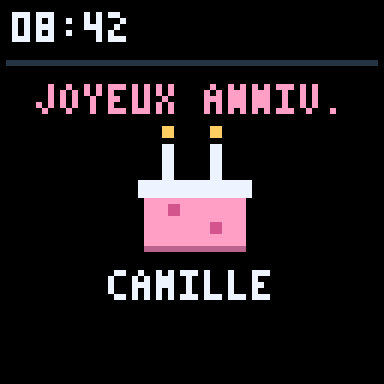 | 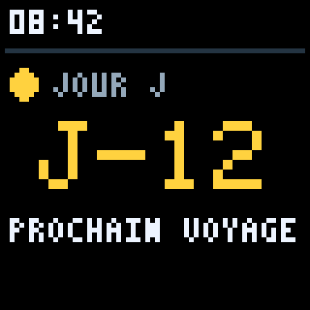 |

These images use the actual 64×64 Rust renderer and fictional data, enlarged without smoothing. The GIF accelerates a 15-minute approach: the mini tram indicates remaining departure time, not a GPS position. Weather is omitted on the PIXOO64; the web interface shown above is unchanged.

| Config — Arrêt | Config — Recherche | Config — Compteur J |
|:---:|:---:|:---:|
| 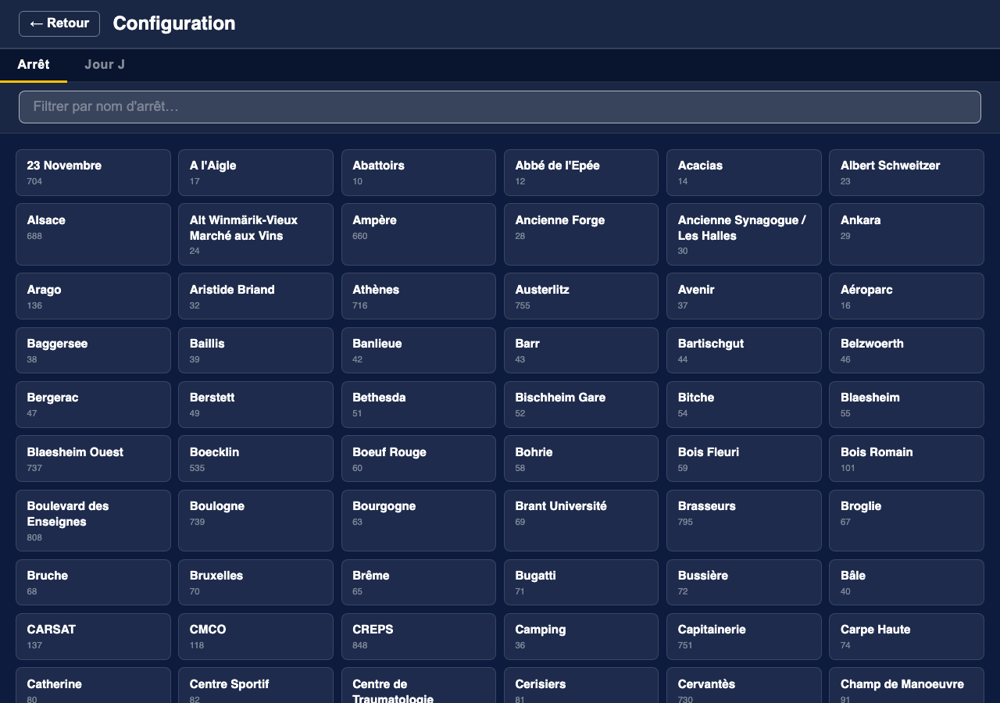 | 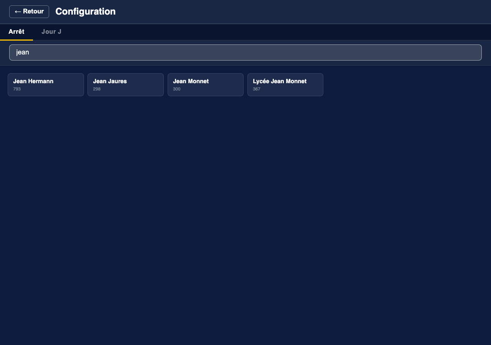 | 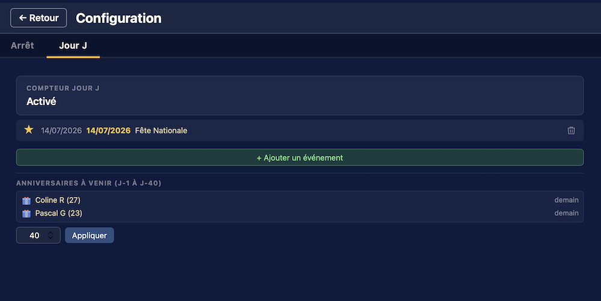 |

---

## Features

- **Live departure board** — next two departures per line/direction, updated in real time via WebSocket
- **Real-time indicator** — bold times = GPS-confirmed, italic = theoretical schedule
- **Multiple stops + rotation** — monitor several stop codes simultaneously; the board rotates through them on a configurable interval; the current stop name and reference code are shown in the stop bar between the header and departure rows
- **Responsive phone portrait layout** — on narrow screens (≤ 480 px, e.g. iPhone), the board switches to a compact 2-line-per-departure layout: line badge spans both lines, destination on top, "Prochain / Suivant" time slots stacked below; the weather footer wraps to two lines; tested via DevTools device emulation (Chrome: Cmd+Shift+M, Safari Develop menu)
- **Touch / swipe** — swipe left/right on mobile and tablet to cycle stops manually
- **Weather widget** — current conditions, daily min/max, precipitation, and UV index in the board footer, powered by [Meteoblue](https://www.meteoblue.com/) (optional); animated weather background (rain, snow, sun, etc.) renders behind the weather strip
- **Ornamental canvas** — arabesque SVG animations progress slowly in the empty zone below the weather banner, cycling through several designs
- **Birthday of the day** — reads a JSON file of contacts and displays today's birthdays with age, when board space permits; J-0 birthdays are excluded from the Jour J row to avoid duplication
- **Jour J countdown** — shows a scrolling marquee of multiple upcoming countdown events, each with a label and icon; events within N days of today are merged with upcoming birthdays in the same row; events at **J-0** (today) blink with a party animation
- **Pixoo64 LED display** — alternates the full *Station* tour with *Strasbourg miniature*: a pixel-art cathedral, the nearest C/D tram, two fixed C/D columns, and an automatic solar day/night cycle. Birthday/Jour-J screens and hot-reloadable timing are retained. Weather is omitted only on the PIXOO64.
- **Stop picker** — browse all CTS stops and switch at runtime without restarting the server
- **Crontab-style query windows** — restrict API polling to specific hours or days using 5-field crontab expressions, supporting different schedules for weekdays vs. weekends
- **Independent simulation modes** — CTS and weather can each be simulated independently; no API keys needed for either
- **System status overlay** — tabbed view showing CTS polling state, Meteoblue weather status, and Jour J event management
- **Single binary** — web UI assets are embedded at compile time; deploy with one file copy

---

## Requirements

- Rust 1.75+ (uses `async fn` in traits via AFIT)
- A CTS Open Data API token — free, request one at <https://www.cts-strasbourg.eu/fr/open-data/>
- *(Optional)* A [Meteoblue](https://www.meteoblue.com/en/weather-api) API key for the weather widget
- *(Optional)* A Divoom Pixoo64 device for the LED display

---

## Build

### Freebox release download

Download `cts-departures-v1.6.5-freebox-aarch64.zip` from the [v1.6.5 release](https://github.com/jib63/CTS_destination/releases/tag/v1.6.5). It contains a static Linux ARM64 binary, an example configuration, installation notes and SHA-256 checksums. Existing installations should replace only the binary and keep their own configuration.

To reproduce this public archive after installing the cross-compilation prerequisites below:

```bash
cargo zigbuild --locked --target aarch64-unknown-linux-musl --release --bin cts-departures
python3 scripts/package_freebox.py
```

The archive and its checksum are written under `target/release-v1.6.5/`. This packaging script uses a public example instead of copying your local configuration.

### On the target machine (Linux aarch64)

```bash
# Development build
cargo build

# Optimised release build (smaller binary, LTO enabled)
cargo build --release
# or use the provided script:
./build_release.sh
```

The release binary is written to `target/release/cts-departures`.

### Cross-compiling from macOS (M1/M2/M3) → Freebox Delta / Linux aarch64

Even though both your Mac and the Freebox are ARM64, the Mac produces a
Mach-O binary (macOS) while the Freebox needs a Linux ELF. The solution is
[`cargo-zigbuild`](https://github.com/rust-cross/cargo-zigbuild): Zig ships
a built-in cross-linker — no Docker, no extra toolchain required.

**One-time setup:**
```bash
cargo install cargo-zigbuild
rustup target add aarch64-unknown-linux-musl
```

`zig` itself is downloaded automatically on first run. You can also install
it manually:
```bash
# macOS aarch64 pre-built binary
curl -fL https://ziglang.org/download/0.13.0/zig-macos-aarch64-0.13.0.tar.xz \
  | tar -xJ -C ~/.local/
export PATH="$HOME/.local/zig-0.13.0:$PATH"   # add to ~/.zshrc to make permanent
```

**Build & deploy:**
```bash
./build_freebox.sh
```

This produces a **fully static ELF binary** (no glibc dependency) in
`dist-freebox/`, then automatically copies it to all three instances on the
Freebox via `scp`:

```
scp -r dist-freebox/cts-departures user@freebox:~/cts/cts-gallia/
scp -r dist-freebox/cts-departures user@freebox:~/cts/cts-jaures/
scp -r dist-freebox/cts-departures user@freebox:~/cts/cts-portehop/
```

Override the remote target with the `REMOTE` environment variable:
```bash
REMOTE=pi@192.168.1.10 ./build_freebox.sh
```

```
dist-freebox/
├── cts-departures    ← statically linked Linux aarch64 ELF, ~3.4 MB
└── config.toml       ← pre-configured with listen_addr = 0.0.0.0:80
```

> **Why `musl` and not `gnu`?**
> `musl` produces a fully static binary with no runtime dependency on the
> Freebox's glibc version. Simpler to deploy, zero "wrong glibc" surprises.
> The binary is ~3.4 MB thanks to `opt-level = "s"` + `lto = true`.

---

## Configuration

Copy and edit `config.toml`. All CTS keys are prefixed `cts_`, weather keys `meteoblue_`, and LED display keys `pixoo64_`.

```toml
# ── CTS API ───────────────────────────────────────────────────────────────────

# Your CTS Open Data API token
cts_api_token = "xxxxxxxx-xxxx-xxxx-xxxx-xxxxxxxxxxxx"

# Stop codes to monitor — TOML inline array.
# Add more entries to rotate between stops automatically.
# Examples: "233A" = Homme de Fer,  "298B" = Jean Jaurès (direction Gare Centrale)
cts_monitoring_ref = ["298B"]

# Seconds each stop is displayed before rotating to the next (multi-stop only)
cts_stop_rotation_in_second = 15

# API polling frequency in minutes
cts_polling_interval_minutes = 2

# Maximum departures to request per API call
cts_max_stop_visits = 10

# Web server address (use 0.0.0.0 to listen on all interfaces)
listen_addr = "0.0.0.0:3000"

# Set to true to use fake CTS data — no API key needed (see Demo mode below)
cts_simulation = false

# Restrict polling to service hours using 5-field crontab expressions.
# Semicolons separate multiple clauses; polling occurs when ANY clause matches.
# Day-of-week: 0 = Sunday … 6 = Saturday
# Examples:
#   Every day 6 h–23 h:                 "* 6-23 * * *"
#   Weekdays 6h–23h, weekends 8h–23h:   "* 6-23 * * 1-5; * 8-23 * * 0,6"
#   Morning + afternoon + evening:      "* 6-9,14-18,22-23 * * *"
cts_always_query = false
cts_query_intervals = "* 6-9,14-17,22-23 * * 1-5; * 6-23 * * 0,6"

# ── Meteoblue weather widget (optional) ──────────────────────────────────────

# meteoblue_enabled = true
# meteoblue_api_key = "YOUR_METEOBLUE_KEY"
# meteoblue_location = "Strasbourg"
# meteoblue_polling_interval_minutes = 60
# meteoblue_simulation = false

# meteoblue_always_query = true   # set false to gate weather polling to a time window
# meteoblue_query_intervals = "* 6-23 * * *"   # same crontab syntax as cts_query_intervals

# ── Divoom Pixoo64 LED display (optional) ────────────────────────────────────

# pixoo64_enabled = true
# pixoo64_address = "192.168.1.42"
# pixoo64_simulation = true               # render PNG preview only, no device calls
# pixoo64_brightness = 80                 # screen brightness 0–100 (sent once at startup)
# pixoo64_tram_screen_seconds   = 6       # seconds each departure screen is shown (1–60)
# pixoo64_moment_screen_seconds = 1       # seconds each birthday/Jour-J screen is shown (1–30)
# pixoo64_lines_per_screen      = 4       # departure rows per screen (1–4)

# ── Birthday feature (optional) ───────────────────────────────────────────────

# birthday_enabled = true
# birthday_file = "data/birthdays.json"

# ── Jour J countdown (optional) ───────────────────────────────────────────────
# Multiple events are supported. Past events are silently ignored at runtime
# and pruned automatically when the config UI is opened.
# Icons: star | party | heart | present | skull
#
# birthday_days_ahead controls how many days ahead upcoming birthdays are shown
# in the Jour J scrolling row (birthdays on day 0 appear in the birthday banner instead).

# jour_j_enabled = true
# birthday_days_ahead = 7
# jour_j_events = [
#   { date = "14/07/2026", label = "Fête Nationale", icon = "star" },
#   { date = "25/12/2026", label = "Noël",           icon = "present" },
# ]
```

Alternatively, store API keys in separate files:

```toml
cts_api_token_file      = "/etc/cts/token"
meteoblue_api_key_file  = "/etc/cts/meteoblue_key"
```

---

## Run

```bash
# With the default config.toml
cargo run --release

# With a custom config file
cargo run --release -- /path/to/my-config.toml
```

Then open <http://localhost:3000> in your browser.

---

## Demo mode (no API keys required)

Both CTS and weather can be simulated independently. Use `demo.toml` for a fully self-contained demo:

```bash
cargo run -- demo.toml
```

`demo.toml` enables simulated CTS departures, simulated weather, birthday display, and Jour J countdowns. Set `cts_demo_lines` to control how many departure rows appear (1–4), leaving room for birthday and Jour J rows.

```toml
cts_api_token        = "demo"
cts_simulation       = true
cts_always_query     = true
cts_demo_lines       = 3        # show 3 lines; leaves room for birthday + Jour J below

meteoblue_enabled    = true
meteoblue_simulation = true
meteoblue_api_key    = "demo"
meteoblue_location   = "Strasbourg"
meteoblue_always_query = true

birthday_enabled     = true
birthday_file        = "data/birthdays.json.demo"

jour_j_enabled       = true
birthday_days_ahead  = 40
jour_j_events        = [{ date = "14/07/2026", label = "Fête Nationale", icon = "star" }]
```

The board updates every polling interval with slightly jittered departure times so the countdown feels alive.

---

## Weather widget

When `meteoblue_enabled = true`, the board footer shows a live weather strip:

```
☁  7°C / 19°C  💧 2.5 mm  UV 3
```

- The **city name** (`meteoblue_location`) is resolved to coordinates via the Meteoblue location search API on startup — no need to supply latitude/longitude manually.
- Weather is polled every `meteoblue_polling_interval_minutes` minutes (default 60).
- An **animated weather background** renders behind the weather strip: falling rain drops, snow flakes, drifting clouds, a spinning sun, flickering lightning, etc. — the animation type is selected automatically from the current Meteoblue pictocode. The background is decorative only; all board content sits above it.
- When too many departure rows are displayed and space is tight, the weather footer shrinks gracefully — departure rows always take priority.
- Use `meteoblue_always_query = false` with `meteoblue_query_intervals` to restrict weather polling to specific hours (same crontab syntax as for CTS).
- Set `meteoblue_simulation = true` to show weather without an API key.

---

## Birthday of the day

When `birthday_enabled = true`, today's birthdays are loaded from a JSON file and shown on the board (both web and Pixoo64) whenever fewer than 4 departure rows are displayed.

**Format** (`data/birthdays.json`):
```json
{
  "birthdays": [
    { "name": "Jean Martin",   "date": "12/04" },
    { "name": "Claire Dupont", "date": "03/07/1985" }
  ]
}
```

- Date format: `DD/MM` (annual, no year) or `DD/MM/YYYY` (age is calculated automatically and shown in parentheses).
- Multiple entries for the same date are all displayed, scrolling across the board.
- Birthdays in the next N days (controlled by `birthday_days_ahead`) also appear in the Jour J scrolling row as upcoming events.

---

## Jour J countdown

When `jour_j_enabled = true`, the board shows a **scrolling marquee** of all upcoming countdown events. Events are defined as a TOML array, each with a date, a label, and an icon:

```toml
jour_j_enabled      = true
birthday_days_ahead = 7

jour_j_events = [
  { date = "14/07/2026", label = "Fête Nationale", icon = "star"    },
  { date = "25/12/2026", label = "Noël",           icon = "present" },
  { date = "31/12/2026", label = "Réveillon",      icon = "party"   },
]
```

**Available icons:** `star` | `party` | `heart` | `present` | `skull`

**Upcoming birthdays** from the birthday file are automatically merged into the Jour J row for birthdays within `birthday_days_ahead` days. Birthdays on day 0 (today) are excluded — they appear in the birthday banner instead.

**J-0 animation:** when an event is today (J‑0), its badge pulses gold and its icon rocks back and forth with confetti sparks.

**Managing events at runtime:** open **Configuration → Jour J** to:
- View the list of current events with date, label, and icon
- Delete any event with the trash button
- Add a new event via the inline form (date, label, icon picker)
- Adjust `birthday_days_ahead`

Past events are pruned automatically whenever the config UI is opened and when saving changes. Events are saved back to `config.toml` and take effect immediately without a restart.

**Pixoo64:** all upcoming birthdays and Jour-J events are shown on a dedicated Birthday/Jour-J screen that paginates automatically when entries overflow. The screen rotates into the normal screen cycle alongside departure and weather screens.

---

## Security

The application is designed to be exposed to the internet via an nginx reverse proxy. Two deployment artefacts are provided in `dist/`:

- `dist/nginx-conf.d-cts.conf` — deploy to `/etc/nginx/conf.d/cts.conf` (geo block + rate-limit zone)
- `dist/nginx-default` — deploy to `/etc/nginx/sites-enabled/default` (virtual host with three instances)

**Geo-based access control** — nginx uses a `geo` block to classify requests as internal (LAN) or external. The variable `$cts_is_external` drives all access decisions:

| Surface | Internal (LAN) | External (internet) |
|---|---|---|
| Departure board (WebSocket) | Full board including birthday and Jour J rows | Board delivered — but `birthdays_today` and `jour_j_events` are **stripped server-side** before transmission |
| `/api/stops`, `/api/config`, `/api/jour-j`, `/api/status` | Allowed | **Blocked by nginx (403)** — never reaches Rust |
| Config and status buttons | Visible | Hidden (UI only — the API block is the real gate) |
| Birthday / Jour J rows | Visible | Hidden (JS) — data is absent from the payload anyway |

**Why strip at the server, not just hide in JS?** JavaScript running in the browser can be modified by anyone. Hiding a UI element does not prevent an attacker from reading the WebSocket frames directly in DevTools. The server maintains two broadcast channels — one full (internal), one stripped (external) — and routes each WebSocket client to the appropriate channel based on the `X-CTS-External` header set by nginx.

**Rate limiting** — `GET /api/stops` and related stop-discovery endpoints are limited to 10 requests/minute per IP (`cts_stops` zone in `nginx-conf.d-cts.conf`).

**Multi-instance nginx config** (`dist/nginx-default`) covers three simultaneous instances:

| Instance | Path prefix | Port |
|---|---|---|
| Jaurès | `/cts/jaures/` | 3000 |
| Gallia | `/cts/gallia/` | 3001 |
| Porte Hop | `/cts/portehop/` | 3002 |

Each instance has its own WebSocket, API, and static asset location blocks. A shared `error_page 502 503 504` serves a French "service indisponible" page (`dist/cts-offline.html`, deploy to `/var/www/html/`) when any backend is down.

---

## Arabesque canvas

The empty zone below the weather banner contains a slow ornamental animation: arabesque SVG designs are drawn progressively (path stroke-dashoffset animation), held briefly, then fade out before the next design begins. Five different designs cycle in sequence. The canvas sits below all other board content and is purely decorative.

---

## Pixoo64 LED display

When `pixoo64_enabled = true`, the Divoom Pixoo64 64×64 LED matrix alternates **Station** and **Strasbourg miniature** automatically. These layouts are specific to the LED display; the web board is unchanged. Weather is never displayed on the Pixoo64, even if it is enabled for the web board.

### Layout

The black background and compact 3×5 pixel font leave room for:

- **Header** — small `HH:MM` clock, stop name (up to 15 characters), and a divider at y=20. A green dot indicates an upcoming real-time departure; amber indicates timetable-only or unavailable departures.
- **Departure rows** (y=23–55) — 1–4 rows with line-color badges, destinations of up to 6 characters, next departure in gold and following departure in dim amber. Both columns are in minutes. Row spacing adapts to the configured line count; bus numbers of up to three characters are supported.
- **Mini tram footer** (y=56–63) — a pixel tram in the nearest displayed departure's line color approaches a stop over a fixed 15-minute horizon. Its position represents remaining time, not GPS location. The label shows `3M`, for example, or `ICI` during the final minute. Expired departures are skipped; missing data never produces a phantom tram.
- **Moment screens** — matching compact clock and black background, birthday cake or event icon, adaptive `J-N` counter, and up to three lines of text.
- **Startup / offline screens** — explicit messages without reserving a weather strip.

Strasbourg miniature uses a narrow, single-spire cathedral and two fixed columns (C on the left, D on the right). Each column shows its nearest departure and destination, then the following departure and its destination, from the same platform. The tram and its large counter use the nearest service's color: orange for C, green for D. Minute suffixes are omitted in this layout; `ICI` indicates the last minute. Missing or expired services are not drawn as approaching trams. Opposite platforms stay separate even when they have the same station name. The shared web data is never modified.

Lighting is calculated locally for Strasbourg (48.5734° N, 7.7521° E) using the [NOAA solar-position approximation](https://gml.noaa.gov/grad/solcalc/solareqns.PDF). UTC-based calculations follow the seasons independently of the VM timezone or daylight-saving changes. The sky blends through dawn, daytime, sunset and night; windows become warm at twilight. The moon is decorative, not a calculated lunar phase. No Meteoblue credits or network requests are required.

Rotation order (v1.6.1): **Station A → Station B → birthdays → events → miniature A → miniature B → birthdays → events → repeat**. Platforms keep their configured order; disabled or empty moments are skipped. Each departure screen uses `pixoo64_tram_screen_seconds`, doubled for Jean Jaurès towards Gare Centrale / Poteries (CTS reference `298B`, called quai A here): **12 seconds instead of 6 by default**, in both designs. This priority follows the platform reference even if the boards are reordered or the service is offline. Moments retain their existing duration. The two miniatures therefore cover both directions without mixing their departures. The worker checks departure screens every second and sends a device command only when the bitmap changes. Fresh API updates do not reset the rotation timer. `pixoo64_lines_per_screen` continues to control Station; the miniature always reserves both C/D columns.

### Editable playlist in the web configuration

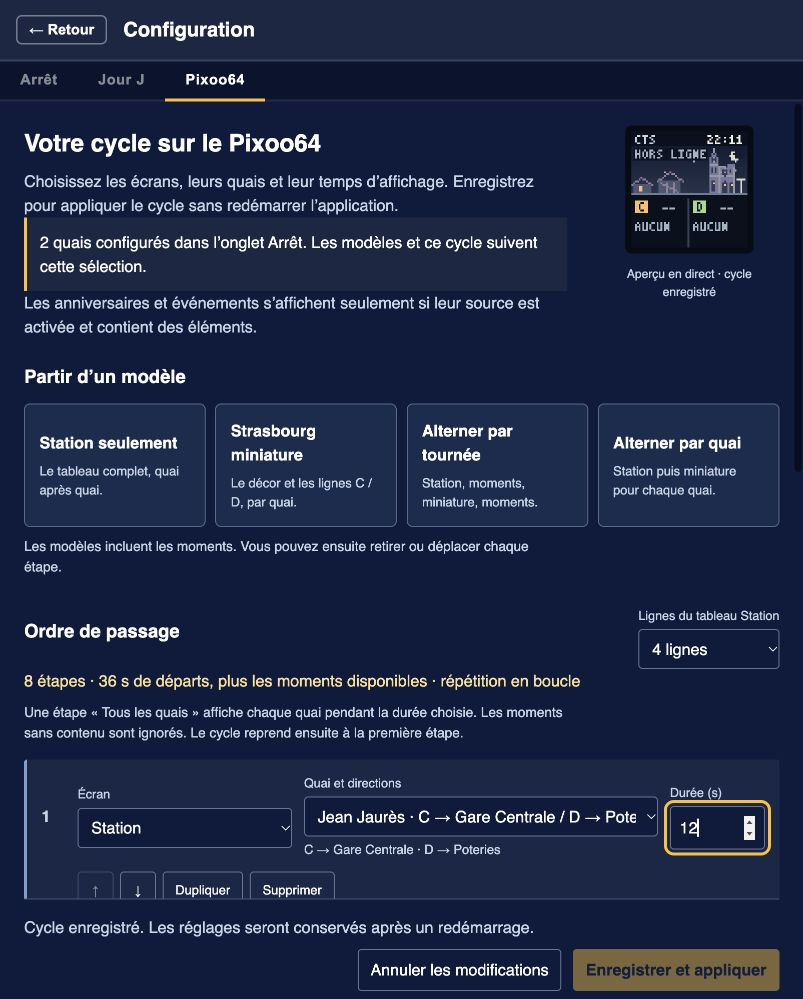

Open **Configuration → Pixoo64**, after **Arrêt** and **Jour J**. Four starting models are available: Station only, Strasbourg miniature only, alternating complete tours, or alternating designs for each platform. Every model can be customized.

Each step has a screen type (`station`, `miniature`, `birthdays`, `events`), an optional platform and a duration from **1 to 300 seconds**. Omit the platform to tour all configured platforms, spending that duration on each. Birthday and event durations apply to each available item; empty moment groups are skipped. Add, duplicate, remove or reorder steps with the buttons. Station can show 1–4 rows; miniature keeps its two C/D columns.

**Enregistrer et appliquer** validates and saves the playlist in `config.toml`, then starts its first step immediately without restarting or redeploying. The live preview shows the saved cycle, not unsaved edits. Invalid values and failed saves leave the running settings unchanged. Existing configurations without a playlist retain the validated v1.6.1 behavior. Once saved, each step's duration is used exactly, without an implicit multiplier for Gare / Poteries.

The editor and its API are available only when `pixoo64_enabled = true`, on the internal configuration interface. The tab stays hidden while the device is disabled. It does not change the web departure board, stop rotation, event sources, weather, or solar lighting. Device activation, address, simulation mode and brightness remain startup settings. Models, platform choices and the effective cycle follow **Arrêt**, including a single selected platform. Steps for removed platforms are omitted. If no departure step matches a completely new selection, the first step of each design is reused for all new platforms with its existing duration. Unsaved edits are retained and adapted when returning to the tab. Saving stores this adapted cycle.

The dedicated API is `GET /api/pixoo64/config` (settings, models and current platforms) and `POST /api/pixoo64/config` with the complete settings:

```json
{
  "lines_per_screen": 4,
  "steps": [
    {"screen": "station", "platform": "298B", "seconds": 12},
    {"screen": "station", "platform": "298A", "seconds": 6},
    {"screen": "birthdays", "seconds": 2},
    {"screen": "events", "seconds": 2},
    {"screen": "miniature", "platform": "298B", "seconds": 12},
    {"screen": "miniature", "platform": "298A", "seconds": 6},
    {"screen": "birthdays", "seconds": 2},
    {"screen": "events", "seconds": 2}
  ]
}
```

The saved `pixoo64_sequence` is a TOML inline table containing `lines_per_screen` and `steps`. The other settings and comments are preserved. Up to 64 steps are supported, with at least one departure screen. After building the local debug binary, run `python3 tests/pixoo_config_integration.py` to check API validation, persistence, access restrictions, failed saves and loading after restart against an isolated simulator.

### Config keys

| Key | Default | Range | Hot-reload |
|-----|---------|-------|-----------|
| `pixoo64_enabled` | `false` | — | No |
| `pixoo64_address` | — | — | No |
| `pixoo64_simulation` | `false` | — | No |
| `pixoo64_brightness` | — | 0–100 | No (startup only) |
| `pixoo64_tram_screen_seconds` | `6` | 1–60 | Yes |
| `pixoo64_moment_screen_seconds` | `1` | 1–30 | Yes |
| `pixoo64_lines_per_screen` | `4` | 1–4 | Yes |

Hot-reload: `POST /api/config {"pixoo64_lines_per_screen": 2}` takes effect on the next rendered frame.

- **Simulation mode** — set `pixoo64_simulation = true` to render frames as PNG previews at `/api/pixoo64/preview` without sending anything to the device.
- **Brightness** — uses `Channel/SetBrightness`; sent once at startup.
- **Preview** — `/api/pixoo64/preview` shows the current bitmap (Station, miniature or moment) used by the device.
- **README images** — regenerate the device screenshots offline with `python3 scripts/capture_pixoo64_gif.py` (Pillow required).

---

## Stop picker

Click the **Configuration** button in the header to browse all CTS stops and switch the monitored stop at runtime. The change is saved back to `config.toml` and a new poll is triggered immediately — no restart needed.

Multiple stops can be monitored simultaneously: the board rotates through them every `cts_stop_rotation_in_second` seconds. On touch screens, swipe left/right to cycle stops manually.

> **Note:** the stop list is fetched from the live CTS API even in simulation mode.

---

## System status

Click the **status dot** (●) in the header to open the system status overlay. It has two tabs:

- **CTS** — monitored stop codes, simulation flag, polling interval, crontab window config, and the timestamp of the next scheduled poll.
- **Météoblue** — resolved location name and coordinates, last fetch time, current weather values, and query window status.

---

## REST & WebSocket API

All `/api/*` endpoints are **blocked by nginx for external (non-LAN) clients** — they return 403 before the request reaches Rust. The WebSocket endpoint is accessible externally but delivers a stripped payload (see [Security](#security) below).

| Endpoint | Description |
|---|---|
| `GET /ws` | WebSocket stream — pushes `DepartureBoard` JSON on every update |
| `GET /api/stops` | List all logical stops (sorted by name) |
| `GET /api/stops/:code/details` | Physical stops and line/directions under a logical code |
| `POST /api/config` | `{"monitoring_refs":["298B"]}` — change monitored stops at runtime |
| `POST /api/jour-j` | `{"events":[{"date":"DD/MM/YYYY","label":"…","icon":"star"}],"birthday_days_ahead":7}` — update Jour J events |
| `GET /api/status` | Polling state, weather status, Jour J events and birthday config |
| `GET /api/pixoo64/preview` | Latest Pixoo64 frame as PNG (simulation mode only) |

---

## Project structure

```
src/
├── main.rs              Entry point and server startup
├── config.rs            TOML config loading, in-place updates, JourJEventConfig
├── cts/
│   ├── client.rs        CTS API client, poll loop, board assembly
│   ├── model.rs         SIRI 2.0 data structures
│   └── simulation.rs    Fake departure data generator
├── departure/
│   └── model.rs         DepartureBoard domain model (JourJEventDisplay, birthday loader)
├── display/
│   └── mod.rs           DisplayRenderer trait
├── meteoblue/
│   ├── client.rs        Location resolution + weather poll loop
│   ├── model.rs         Meteoblue API types and WeatherSnapshot
│   └── simulation.rs    Fixed offline weather values
├── pixoo64/
│   ├── draw.rs          Ambient Hub frame renderer (hub + moment screens, color palette)
│   ├── font.rs          Embedded 5×7 bitmap font
│   └── renderer.rs      Cycle state machine, pixoo_worker, DisplayRenderer impl
└── web/
    ├── mod.rs           AppState, CronMatcher, interval parsing
    ├── router.rs        Axum routes and REST handlers
    └── ws.rs            WebSocket connection lifecycle
static/
├── index.html           Board UI shell (departure board + stop bar + overlays + SVG weather sprites)
├── app.js               WebSocket client, rendering logic, stop bar update, weather bg, arabesque canvas
└── style.css            Board styles, phone portrait media query (≤480 px), J-0 party animations, weather bg keyframes
data/
├── birthdays.json        Birthday list (DD/MM or DD/MM/YYYY format)
└── birthdays.json.demo   Demo birthday list used with demo.toml
export_birthdays.applescript   macOS Contacts → birthdays.json exporter
```

See [ARCHITECTURE.md](ARCHITECTURE.md) for a full description of the data flow, concurrency model, and design decisions.

---

## License

MIT — see [LICENSE](LICENSE).
